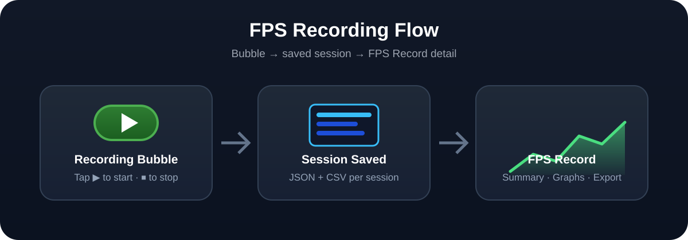
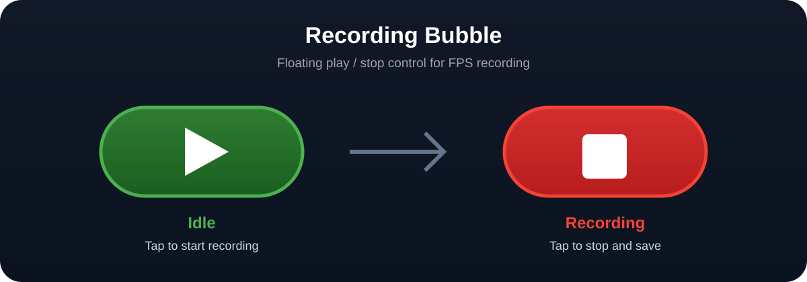

# GameBar - Real-time Performance Overlay for Android

[](https://opensource.org/licenses/Apache-2.0)
[](https://www.android.com)
[](https://android-arsenal.com/api?level=33)

GameBar is a comprehensive real-time performance monitoring overlay for Android devices. It provides detailed system metrics including FPS, CPU/GPU usage, temperatures, and memory statistics with a customizable floating overlay.

## Features

- **Real-time FPS Monitoring** - Track frame rates with multiple measurement methods
- **CPU Metrics** - Usage percentage, per-core frequencies, and temperature
- **GPU Metrics** - Usage, clock speed, and temperature
- **Memory Stats** - RAM usage, speed, and temperature
- **Battery Temperature** - Monitor device thermal status
- **Customizable Overlay** - Adjustable position, size, colors, and transparency
- **Per-App Configuration** - Auto-enable GameBar for specific applications
- **FPS Recording** - Session-based FPS logs with summary cards, graphs, and CSV/PNG export
- **Recording Bubble** - Floating play/stop bubble for manual recording, plus auto-record for selected apps
- **Gesture Controls** - Single-tap format toggle, long-press actions, and drag to move
- **Device-Specific Overlays** - Easy hardware path configuration per device

## Screenshots

### GameBar Settings & Customization
<p align="center">
  
  
  
</p>
<p align="center">
  
  
  
</p>

### In-Game Overlay
<p align="center">
  
  
  
</p>
<p align="center">
  
  
  
</p>

### FPS Recording & Bubble
<p align="center">
  
</p>
<p align="center">
  
</p>

## Requirements

- Android 13 (API 33) or higher
- KernelSU, Magisk, or APatch (for the system-support module)
- Root access to flash the module and grant permissions

## Building

### Prerequisites

- JDK 17
- Android SDK Platform 35 (platform + build-tools)
- `ANDROID_HOME` environment variable or `local.properties` pointing to the SDK

### Build APK + Module

This fork builds with Gradle, so no AOSP/LineageOS source tree is required:

```bash
# Builds both the standalone APK and the flashable module
bash build_module.sh
```

Outputs:

- `out/GameBar.apk` — standalone APK
- `out/GameBar-Module-v1.0.zip` — KernelSU / Magisk / APatch module

Individual tasks:

```bash
bash ./gradlew copyApk        # APK only       -> out/GameBar.apk
bash ./gradlew packageModule  # APK + module   -> out/GameBar-Module-v1.0.zip
```

### Hardware paths

Default sysfs paths live in `res/values/config.xml`. GameBar also auto-detects many nodes at runtime via `SysfsDetector`, so most devices work without changes. Edit `res/values/config.xml` only if your device uses different paths.

## Installation

The app and the root module are installed separately.

1. **Flash the module** (`out/GameBar-Module-v1.0.zip`) with KernelSU, Magisk, or APatch, then reboot. The module applies SELinux rules, makes the required sysfs nodes readable (read-only `0644`), and grants runtime permissions/appops after boot.

2. **Install the APK** independently:
   ```bash
   bash install_apk.sh
   ```
   or manually:
   ```bash
   adb install -r out/GameBar.apk
   ```
   If you install the APK manually after the module has already booted, run `bash install_apk.sh` or reboot once so the module can grant permissions.

The APK (`com.android.gamebar.fork`) stays installed and launches even when the module is disabled or removed. Without the module, metrics that require root/sysfs access show as "N/A".

## Finding Device-Specific Paths

Use these ADB commands to verify or adapt paths for your device:

```bash
# Find CPU thermal zones
adb shell "for i in /sys/class/thermal/thermal_zone*/type; do echo \$i: \$(cat \$i); done" | grep -i cpu

# Find GPU thermal zones  
adb shell "for i in /sys/class/thermal/thermal_zone*/type; do echo \$i: \$(cat \$i); done" | grep -i gpu

# Find RAM/DDR thermal zones
adb shell "for i in /sys/class/thermal/thermal_zone*/type; do echo \$i: \$(cat \$i); done" | grep -i ddr

# Check GPU paths
adb shell "ls -la /sys/class/kgsl/kgsl-3d0/"

# Check FPS path
adb shell "cat /sys/class/drm/sde-crtc-0/measured_fps"

# Check RAM frequency path
adb shell "cat /sys/devices/system/cpu/bus_dcvs/DDR/cur_freq"
```

## Configuration

### Overlay Customization

GameBar supports runtime customization through Settings:

- **Display Options**: Toggle individual metrics (FPS, CPU, GPU, RAM, temperatures)
- **Visual Style**: Adjust text size, colors, background transparency, corner radius
- **Position**: Choose from 9 predefined positions or enable draggable mode
- **Update Interval**: Set refresh rate (500ms - 5000ms)
- **FPS Method**: Choose between new (SurfaceFlinger) or legacy (sysfs) measurement

### Per-App Auto-Enable

Configure GameBar to automatically activate for specific apps:

1. Open GameBar Settings
2. Navigate to "Per-App GameBar" → "Configure Apps"
3. Select apps from the list
4. GameBar will auto-enable when those apps are in foreground

## Usage

### Quick Settings Tile

1. Add GameBar tile to Quick Settings
2. Tap to toggle overlay on/off
3. Long-press tile to open settings

### Gesture Controls

- **Single-tap**: Switch between full and minimal overlay formats
- **Long-press**: Open GameBar settings
- **Drag**: Move overlay (when draggable mode enabled)

### FPS Recording

GameBar records complete FPS sessions with the metrics needed for performance analysis:

- **Auto-record selected apps**: Start a session automatically when a configured app is in the foreground
- **Recording bubble**: Tap the floating play button to start; it turns into a stop button while recording
- **FPS Record**: Browse saved sessions, open the detail dashboard, and compare FPS, CPU, GPU, RAM, temperature, and power data
- **Export**: Export or share each session as CSV, and export or share the dashboard as PNG

All sessions are saved under `Documents/GameBar/FPSRecordings/{package}/`, with an app-specific fallback when shared storage is unavailable. Sessions are kept until you delete them manually.

## SELinux Policy

The root module ships `module/sepolicy.rule`, which grants the app read access to:

- Thermal sysfs (`sysfs_thermal`)
- Graphics / KGSL sysfs (`vendor_sysfs_graphics`, `vendor_sysfs_kgsl`)
- Battery and USB supply sysfs
- `/proc/stat`

No ROM rebuild is required; KernelSU / Magisk / APatch applies the rules at boot. The `sepolicy/` and `gamebar.mk` files are legacy ROM-build leftovers and are not used by the standalone build.

## Permissions

The module (`module/service.sh`) and `install_apk.sh` grant or allow:

- `SYSTEM_ALERT_WINDOW` (appops) - Overlay display
- `PACKAGE_USAGE_STATS` / `GET_USAGE_STATS` (appops) - Foreground app detection for auto-recording
- `WRITE_EXTERNAL_STORAGE`, `READ_EXTERNAL_STORAGE`, `MANAGE_EXTERNAL_STORAGE` - Recording CSV storage
- `ACCESS_FPS_COUNTER` - FPS measurement
- `WRITE_SECURE_SETTINGS` - Configuration persistence
- `POST_NOTIFICATIONS` - Recording notification

With the module installed these are applied automatically after boot. If you install the APK manually, run `bash install_apk.sh` (it grants them) or grant them yourself via `adb`/root.

## Troubleshooting

### Overlay not showing
- Check overlay permission in Settings → Apps → GameBar
- Make sure the root module is installed, enabled, and the device has been rebooted
- Verify SELinux is not blocking (check `adb logcat | grep avc`)
- Ensure the sysfs nodes are readable (`adb shell ls -l /sys/class/...`)

### Metrics showing "N/A"
- Install the root module and reboot; without it, sysfs reads may be denied
- Verify paths in `res/values/config.xml` match your device (or rely on auto-detection)
- Check file permissions: `adb shell cat /sys/class/thermal/thermal_zone*/temp`
- Review logcat for file access errors

### Temperature values incorrect
- Adjust divider values in `res/values/config.xml`
- Most devices use 1000 (millidegrees) or 10 (decidegrees); auto-detection usually handles this
- Test: `adb shell cat <temp_path>` and divide manually

### Recording issues
- Make sure Usage Access is granted for automatic recording
- Check that the target app is enabled under **Recording → Recording Apps**
- For manual recording, enable **Recording bubble** and tap the play button
- Recordings are saved even when the overlay is hidden; the bubble can run independently

### Build / module errors
- Ensure JDK 17 and Android SDK 35 are installed, with `local.properties` pointing to the SDK
- Make sure `libs/hidden-api.jar` exists (compileOnly dependency)
- Run `bash ./gradlew clean` before rebuilding
- The flashable module is generated at `out/GameBar-Module-v1.0.zip`

## Contributing

Contributions are welcome! Please:

1. Fork the repository
2. Create a feature branch
3. Make your changes
4. Test on your device
5. Submit a pull request

## License

```
Copyright (C) 2025 kenway214

Licensed under the Apache License, Version 2.0 (the "License");
you may not use this file except in compliance with the License.
You may obtain a copy of the License at

    http://www.apache.org/licenses/LICENSE-2.0

Unless required by applicable law or agreed to in writing, software
distributed under the License is distributed on an "AS IS" BASIS,
WITHOUT WARRANTIES OR CONDITIONS OF ANY KIND, either express or implied.
See the License for the specific language governing permissions and
limitations under the License.
```

## Credits

- **Fork Maintainer & Module Packaging**: [Bryan16](https://github.com/Bryan16-ly)
- **Original Project**: [Pong-Development/packages_apps_GameBar](https://github.com/Pong-Development/packages_apps_GameBar) & [kenway214](https://github.com/kenway214)
- Built for LineageOS, AOSP, and systemless root (KernelSU / Magisk / APatch)
- [ColorPicker](https://github.com/jaredrummler/ColorPicker)

## Support

- **Fork Repository**: [https://github.com/Bryan16-ly](https://github.com/Bryan16-ly)
- **Original Issues**: [Pong-Development GitHub Issues](https://github.com/Pong-Development/packages_apps_GameBar/issues)

---

**Note**: Starting from the latest refactor, the **GameBar APK is installed independently** via Android Package Manager (`bash install_apk.sh`), while the **KernelSU / Magisk / APatch module** (`out/GameBar-Module-v1.0.zip`) provides SELinux rules and hardware sysfs node access. If the root module is disabled or removed, the GameBar application remains installed and functional without getting uninstalled or crashing. Package name is `com.android.gamebar.fork` for safe coexistence with ROM-bundled versions.